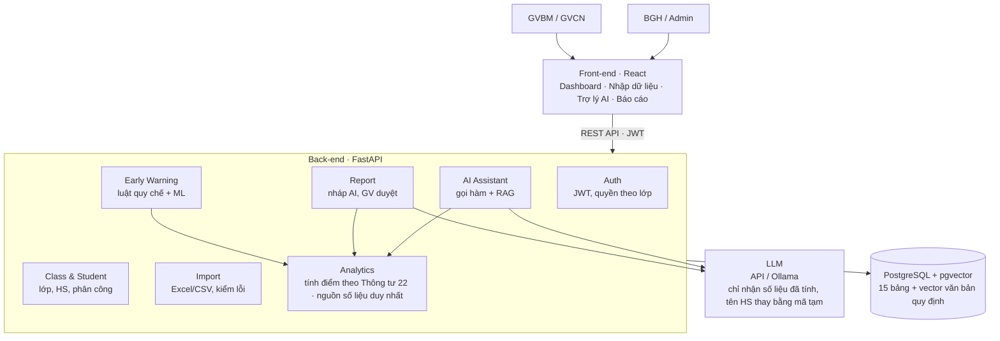
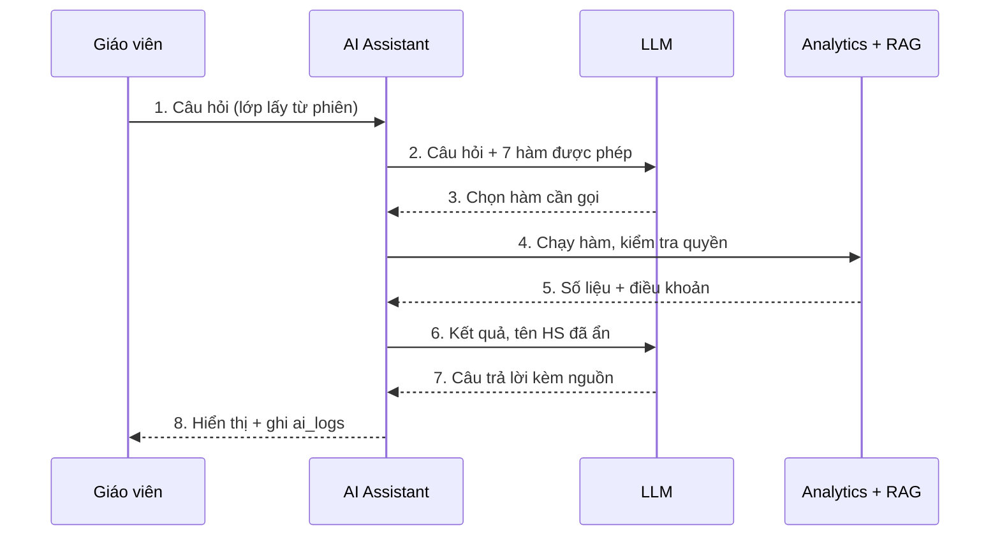
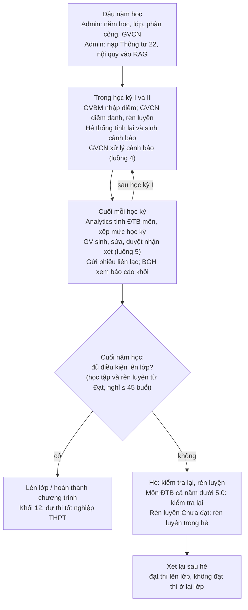
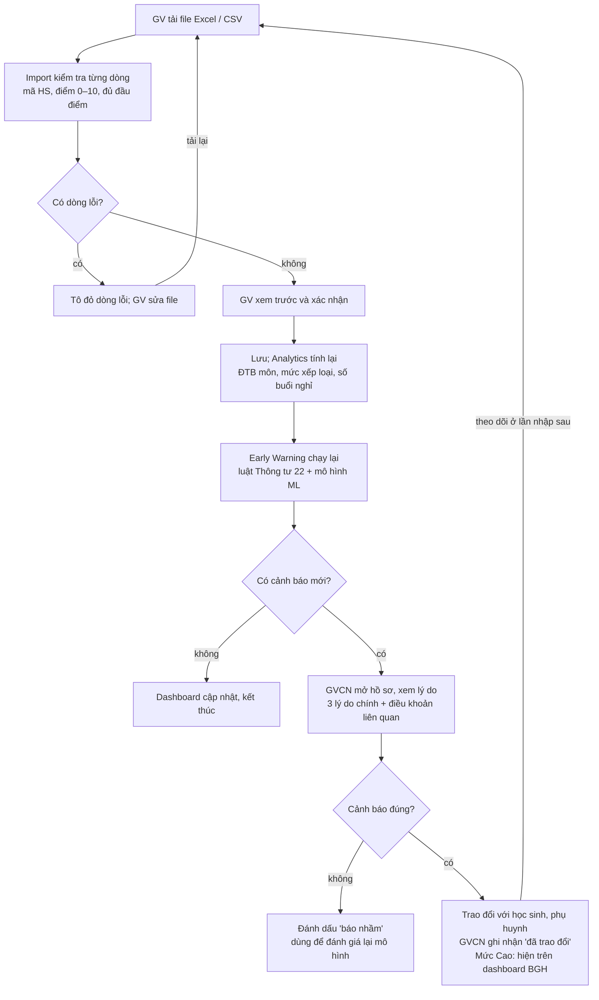
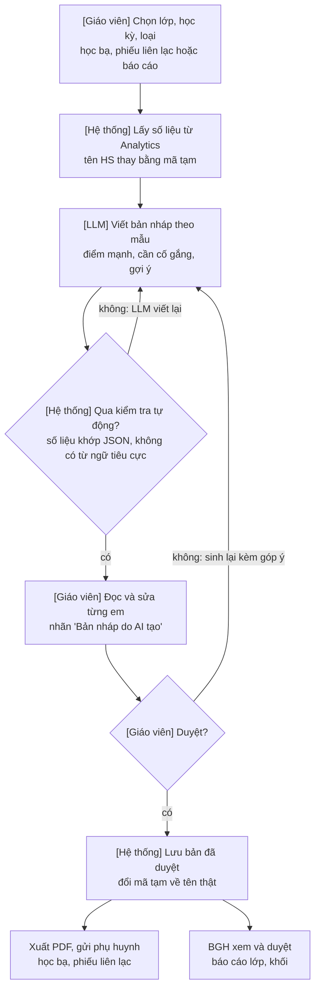

# Sơ đồ kiến trúc và luồng hoạt động

Bản Mermaid của các sơ đồ trong `docs/DESIGN.md` (mục 3, 6.3 và 9). Khi có khác biệt, `DESIGN.md` là chuẩn.

## 1. Kiến trúc tổng thể (DESIGN mục 3)

## 2. Xử lý một câu hỏi của trợ lý AI (DESIGN mục 6.3)

## 3. Chu trình một năm học (DESIGN mục 9.1)

## 4. Nhập dữ liệu → cảnh báo → xử lý (DESIGN mục 9.2)

## 5. Sinh nhận xét và duyệt (DESIGN mục 9.3)

